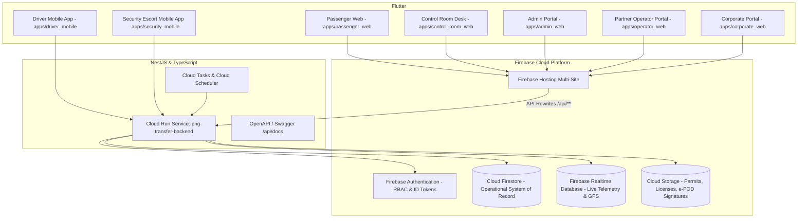

# AeroTrans PNG2 - website and mobile applications

## Website source

The Flutter website is in **[apps/passenger_web](apps/passenger_web)**.
For the unified Customer, Control Room, Driver and Manager/Supervisor website,
use **[lib/main_connected.dart](apps/passenger_web/lib/main_connected.dart)**.
The NestJS backend is in **[backend](backend)**.

**[Website build and hosting guide](docs/website.md)** explains the build command,
hosting output folder and backend configuration still needed for public access.
This is a Flutter Web application; the repository root is not a static HTML site.

## Connected and offline review applications

The unified backend-connected review app is now available in source at
**apps/passenger_web/lib/main_connected.dart**. It supports Customer, Control
Room, Driver and Manager/Supervisor in one app, using Firebase authentication and
backend-authorized workspaces. See **[docs/connected-review.md](docs/connected-review.md)**.
Build the single APK with `npm run demo:connected:android`, or update a connected
phone with `npm run demo:connected:phone -- -DeviceSerial <serial>`.

This repository contains source, not deployed services or APK binaries. The current
connected runtime uses local NestJS/Firebase emulators and USB forwarding. Remote
supervisor access still requires a separately configured hosted test environment.
The standalone offline APK remains a separate mode.

To compile the unified website from `apps/passenger_web`, use:

```powershell
flutter build web --no-pub --target lib/main_connected.dart --dart-define=AEROTRANS_CONNECTED_REVIEW=true --no-web-resources-cdn
```

For local browser review, start the existing services first, then use `flutter run
-d chrome --target lib/main_connected.dart --dart-define=AEROTRANS_CONNECTED_REVIEW=true
--web-port=5001` in that app. This uses the same local backend and real account roles.
See [source publication notes](SOURCE_PUBLICATION.md) for the clean repository snapshot.

The current standalone demo is **one APK containing all four roles**:
**Android APKs/aerotrans-all-roles-offline.apk**, launcher **AeroTrans Demo**.
Use **[docs/all-roles-offline-demo.md](docs/all-roles-offline-demo.md)** for the
walkthrough and direct build/install command. All roles share saved practice data
inside this one installation. No internet, computer or USB is needed during use.
The online/backend version and its existing APKs remain separate and intact.

The earlier four-APK offline export is superseded: it had missing Android native
storage registration. The build helpers now prepare and verify registration;
send the corrected combined APK instead of the earlier four-APK ZIP.

The current implementation supports an isolated local four-role demonstration.
Use **[docs/android-demo.md](docs/android-demo.md)** for phone installation and
the walkthrough, and **[AEROTRANS_PNG2_ANDROID_DEMO_REPORT.md](AEROTRANS_PNG2_ANDROID_DEMO_REPORT.md)**
for actual verification and remaining release work. The Batch A report is historical.

- Target stack remains NestJS, Firebase and Flutter. No React/SQLite backend.
- Canonical contracts: [docs/contracts-v1.md](docs/contracts-v1.md).
- Four primary apps and duplicate review: [docs/application-structure.md](docs/application-structure.md).
- The four primary apps launch Firebase-authenticated, navy/gold role workflows.
  Customer booking, dispatch, driver OTP/trip progress and supervisor management
  share authoritative NestJS/Firestore state. Unconverted legacy APIs return 503.
- Explicit demo setup provides labelled local accounts/fleet, with no automatic
  bookings. Test fares require the demo backend command; payments stay pending.
- Default project is demo-aerotrans-png2. Production startup and operational seeds
  are disabled. Do not deploy historical infrastructure examples.

The architecture overview below records intended product scope. Statements about
production readiness or live providers are not verification of the current system.
Historical deployment instructions below are not part of the local demo workflow.

---

# PNG Secure Airport Ground Transportation, Armed Escort & Control Room Platform
## Production Architecture: Firebase + Google Cloud Run + Flutter

An enterprise-grade, multi-airport Ground Transportation, Armed Security Escort, Aviation Flight Coordination, Incident Command, Billing & Financial Ledger Platform designed specifically for the operating conditions of **Papua New Guinea (PNG)**.

**Pilot Location:** Lae, Morobe Province  
**Primary Airport:** Nadzab / Tomodachi International Airport (AYNZ / LAE)  
**Corridor:** Markham Valley / Highlands Highway (42.5 km to Lae Port / CBD)  
**Currency:** Papua New Guinea Kina (PGK) • **Timezone:** Pacific/Port_Moresby (UTC+10)

---

## 🏗️ High-Level System Architecture



---

## 📱 Application Ecosystem (`apps/`)

| Application | Platform | Target Role | Key Capabilities |
| :--- | :--- | :--- | :--- |
| **`passenger_web`** | Flutter Web | Passengers / Travel Bookers | Nadzab transfer wizard, vehicle selection, armed escort booking, dynamic PGK quote, QR/OTP pass presentation. |
| **`control_room_web`** | Flutter Web | Dispatchers / Operations Room | Real-time flight arrivals board (Air Niugini / PNG Air), conflict-free dispatch matrix, active convoy radar, P1 SOS command console. |
| **`admin_web`** | Flutter Web | Executive Supervisors / Admins | Fleet master, driver & armed guard licensing compliance, rate card configuration, financial controls, and audit trails. |
| **`operator_web`** | Flutter Web | 3rd-Party Fleet Partners | Roster management, transfer assignment acceptance, 80/20 revenue settlement statements, and compliance document uploads. |
| **`corporate_web`** | Flutter Web | B2B Mining & Corporate Clients | Corporate travel desk, purchase order (PO) credit approvals, employee travel manifests, monthly tax invoices. |
| **`driver_mobile`** | Android & iOS | Commercial Drivers | Offline-first mission board, mandatory pre-trip safety checklist, passenger QR/OTP verification, GPS telemetry streaming, e-POD signature capture. |
| **`security_mobile`** | Android & iOS | Armed Escort / Close Protection | Threat level protocols, tactical radio check-ins, firearm permit validation, one-touch P1 emergency SOS panic alarm. |

---

## ⚡ Cloud Run Backend (`backend/`)

Built with **NestJS**, **TypeScript**, and **Firebase Admin SDK**:
- **Port:** `8080` (Standard for Google Cloud Run)
- **API Documentation:** OpenAPI / Swagger interactive documentation at `/api/docs`
- **Health Check Probe:** `/api/v1/health`
- **12 Dedicated Domain Modules:**
  1. `airports`: Geofences, runway specifications, and curbside staging zones.
  2. `quotations`: Dynamic fare calculator (vehicle category, distance, night surcharge, armed escort add-ons, 10% PNG GST).
  3. `availability`: Conflict-free resource availability and double-booking prevention engine.
  4. `bookings`: 8-step booking lifecycle state machine, cryptographic QR tokens, and 6-digit offline verification OTPs.
  5. `resources`: Fleet roster, qualified drivers, and licensed armed security officers.
  6. `dispatch`: Compliance-verified assignment matrix and driver pre-trip inspection workflows.
  7. `flights`: Real-time aviation tracking for Air Niugini (`PX`) and PNG Air (`CG`) with automatic delay recalculation.
  8. `trips`: Real-time transit execution, GPS breadcrumb ingestion to Firebase Realtime Database, and electronic Proof of Delivery (e-POD).
  9. `incidents`: Emergency panic SOS, P1-P4 incidents, convoy escalation, and quick response force (QRF) dispatching.
  10. `payments`: PNG tax invoices, double-entry accounting ledger journals, HMAC-SHA256 webhook signatures, and 80/20 partner settlements.
  11. `compliance`: Driver license expiry, vehicle roadworthy inspection expiry, and firearm permit tracking with automated suspension alerts.
  12. `reports`: Control Room operational dashboard metrics and airport KPIs.
  13. `offline-sync`: Monotonic idempotent event queue with client-side UUIDv4 deduplication.

---

## 🔒 Security & Compliance Architecture

- **Multi-Tenant Isolation:** Enforced at both Cloud Run service layer and Cloud Firestore Security Rules.
- **Role-Based Access Control (RBAC):** Strict hierarchy (`SUPER_ADMIN`, `DISPATCHER`, `OPERATOR`, `DRIVER`, `SECURITY`, `CORPORATE_BOOKER`, `PASSENGER`).
- **Cryptographic Passenger Verification:** Verification requires scanning a SHA-256 QR code or entering a 6-digit offline OTP generated upon booking confirmation.
- **Double-Entry Financial Ledger:** Every transaction generates balanced debits and credits in `financial_journals` tracking PNG GST (10%) payable to the Internal Revenue Commission (IRC).

---

## 🚀 Running the System

### 1. Cloud Run Backend
```bash
cd backend
npm install
npm run build
npm run start:prod
# Visit http://localhost:8080/api/docs for Swagger Documentation
```

### 2. Flutter Applications
```bash
# Control Room Web
cd apps/control_room_web
flutter run -d chrome

# Passenger Web
cd apps/passenger_web
flutter run -d chrome

# Driver Mobile App
cd apps/driver_mobile
flutter run

# Security Escort Mobile App
cd apps/security_mobile
flutter run
```

### 3. Deploying to Google Cloud Run & Firebase
```bash
# Deploy Backend to Google Cloud Run
cd backend
gcloud run deploy png-transfer-backend \
  --source . \
  --region asia-southeast1 \
  --allow-unauthenticated

# Deploy Firebase Rules & Hosting Sites
firebase deploy --only firestore:rules,firestore:indexes,database,storage,hosting
```
