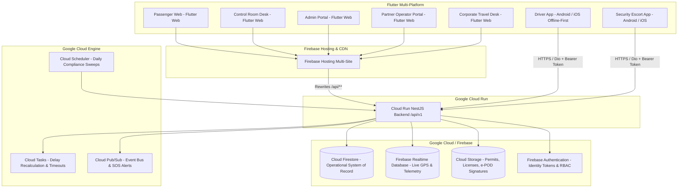

# Papua New Guinea Airport Transfer, Armed Escort & Control Room Platform
## Enterprise System Architecture Specification (Firebase + Google Cloud Run + Flutter)

### 1. Architectural Philosophy
The platform delivers high-security, resilient ground transportation and armed escort coordination tailored for Papua New Guinea operational conditions (specifically the pilot location in Lae, Morobe Province connecting Nadzab / Tomodachi International Airport [AYNZ] with the industrial port city of Lae along the Highlands Highway).

---

### 2. Division of Responsibility & Data Ownership

| Subsystem | Technology | Authoritative Responsibility |
| :--- | :--- | :--- |
| **Identity & Authentication** | Firebase Authentication | User identity, email/phone OTP, session revocation, and verified ID tokens. |
| **Operational System of Record** | Cloud Firestore | Bookings, resource master data, atomic reservation holds, quotations, dispatches, compliance audits, invoices, and immutable event logs. |
| **Live Telemetry & Signals** | Firebase Realtime Database | Sub-second active vehicle GPS coordinates, driver online presence, and zero-latency P1 emergency SOS broadcasts. |
| **Document & Evidence Vault** | Cloud Storage for Firebase | Driver licenses, vehicle roadworthiness certificates, firearm permits, incident scene photos, and e-POD signature captures. |
| **Trusted Business Logic** | Google Cloud Run (NestJS) | Dynamic pricing with 10% PNG GST, atomic double-booking prevention, dispatch compliance verification, flight radar polling, webhook signature verification, and 80/20 partner settlements. |
| **Async Tasks & Jobs** | Cloud Tasks & Scheduler | Scheduled flight monitoring, 10-minute driver acknowledgment timeouts, and daily 06:00 AM compliance sweeps. |

---

### 3. Pilot Deployment: Lae, Morobe Province

- **Airport**: Nadzab Tomodachi International Airport (AYNZ / LAE).
- **Corridor**: 42.5 km along the Markham Valley / Highlands Highway.
- **Base Command**: Nadzab Airport Base Command & Depot (`branch_nadzab_lae`).
- **Standard Threat Levels**:
  - `Level 1 - Low`: Standard daytime transfer (Sedan or SUV).
  - `Level 2 - Elevated`: Night transfers (20:00 - 06:00) requiring onboard security officer.
  - `Level 3 - High Risk`: Armed chase car (Toyota LandCruiser 79 with licensed RPNGC private security detail) for corporate minerals/banking delegations.
  - `Level 4 - Tactical Convoy`: Armored B6 Prado + Lead LandCruiser + Tactical Close Protection Officers.

