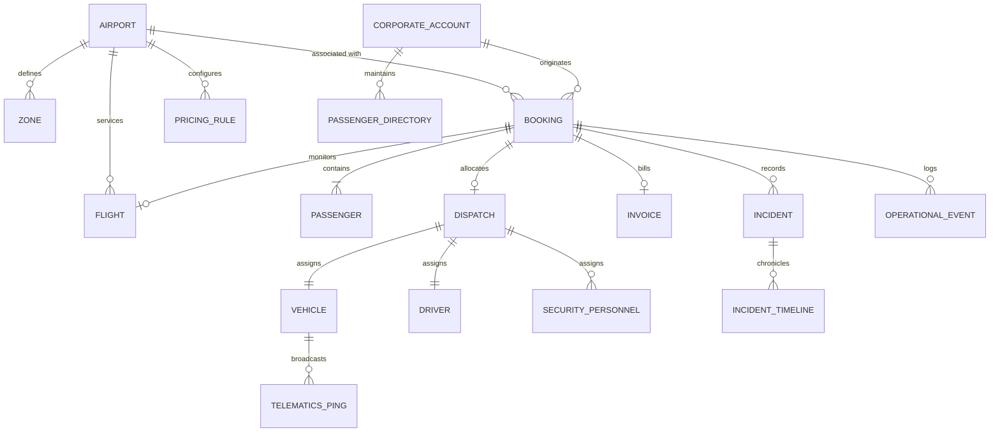

# Entity Relationship Diagram (ERD) & Data Model Specification

### 1. Conceptual Model Overview

---

### 2. Core Entities & Schema Definition

#### A. Master Data: Airports & Zones
- **`airport.transfer.airport`**:
  - `id`: Integer (PK)
  - `name`: Char (e.g., "Nadzab Tomodachi International Airport", "Jacksons International Airport")
  - `iata_code`: Char(3) (e.g., "LAE", "POM", "HGU")
  - `icao_code`: Char(4) (e.g., "AYNZ", "AYPY", "AYMH")
  - `country_id`: Many2one (`res.country`)
  - `province`: Char (e.g., "Morobe", "National Capital District")
  - `city`: Char (e.g., "Lae", "Port Moresby")
  - `timezone`: Selection/Char (e.g., "Pacific/Port_Moresby")
  - `latitude`, `longitude`: Float (GPS center)
  - `service_radius_km`: Float
  - `geofence_polygon`: Text (GeoJSON Polygon)
  - `commercial_enabled`: Boolean
  - `transfer_enabled`: Boolean
  - `meet_greet_enabled`: Boolean
  - `security_service_enabled`: Boolean
  - `arrival_instructions`: Text
  - `departure_instructions`: Text
  - `emergency_contact`: Char
  - `operations_contact`: Char
  - `active`: Boolean

- **`airport.transfer.zone`**:
  - `id`: Integer (PK)
  - `airport_id`: Many2one (`airport.transfer.airport`)
  - `name`: Char (e.g., "Lae Port / Industrial Sector", "Waigani Diplomatic Quarter")
  - `zone_type`: Selection (`airport`, `perimeter`, `city`, `hotel_district`, `industrial`, `mining_site`, `high_risk`)
  - `polygon`: Text (GeoJSON boundary)
  - `center_latitude`, `center_longitude`: Float
  - `radius_km`: Float
  - `risk_level`: Selection (`low`, `medium`, `high`, `extreme`)
  - `serviceable`: Boolean
  - `pricing_tier`: Char

#### B. Commercial & Booking Entities
- **`airport.transfer.corporate.account`**:
  - `id`: Integer (PK)
  - `name`: Char (Company Name)
  - `partner_id`: Many2one (`res.partner`)
  - `credit_limit`: Monitary
  - `payment_terms_id`: Many2one (`account.payment.term`)
  - `cost_centers`: One2many
  - `authorized_bookers`: Many2many (`res.partner`)
  - `monthly_billing_enabled`: Boolean
  - `approval_required_for_vip`: Boolean
  - `active`: Boolean

- **`airport.transfer.booking`**:
  - `id`: Integer (PK)
  - `name`: Char (Format: `PNG-TR-YYYYMMDD-XXXXX`)
  - `booking_date`: Datetime
  - `booking_channel`: Selection (`mobile`, `web`, `corporate_portal`, `call_center`, `control_room`, `api`, `walk_in`)
  - `customer_id`: Many2one (`res.partner`)
  - `corporate_account_id`: Many2one (`airport.transfer.corporate.account`)
  - `airport_id`: Many2one (`airport.transfer.airport`)
  - `service_type`: Selection (`airport_to_hotel`, `hotel_to_airport`, `airport_to_office`, `point_to_point`, `vip_security`, `charter_shuttle`)
  - `transfer_direction`: Selection (`arrival`, `departure`, `point_to_point`)
  - `pickup_location`, `pickup_latitude`, `pickup_longitude`: Location details
  - `destination`, `destination_latitude`, `destination_longitude`: Destination details
  - `pickup_datetime`: Datetime
  - `flight_number`: Char
  - `flight_id`: Many2one (`airport.transfer.flight`)
  - `passenger_count`: Integer
  - `baggage_count`: Integer
  - `vehicle_category_id`: Many2one (`airport.transfer.vehicle.category`)
  - `meet_greet_required`: Boolean
  - `security_required`: Boolean
  - `special_assistance`: Text
  - `subtotal`, `tax`, `discount`, `total`: Monetary (PGK)
  - `currency_id`: Many2one (`res.currency`)
  - `payment_status`: Selection (`unpaid`, `pending`, `authorized`, `paid`, `corporate_credit`, `refunded`)
  - `state`: Selection (`draft`, `quotation`, `awaiting_payment`, `confirmed`, `flight_monitoring`, `resource_planning`, `ready_for_dispatch`, `dispatched`, `driver_en_route`, `at_airport`, `passenger_located`, `passenger_verified`, `passenger_onboard`, `transfer_in_progress`, `arrived_destination`, `passenger_dropped_off`, `completed`, `invoiced`, `closed`, `on_hold`, `cancelled`, `no_show`, `flight_cancelled`, `incident`, `aborted`)

- **`airport.transfer.passenger`**:
  - `id`: Integer (PK)
  - `booking_id`: Many2one (`airport.transfer.booking`)
  - `partner_id`: Many2one (`res.partner`)
  - `first_name`, `last_name`: Char
  - `mobile`, `email`: Char
  - `passenger_type`: Selection (`primary`, `guest`, `vip`, `employee`)
  - `verification_method`: Selection (`qr_code`, `otp`, `manual_audit`)
  - `qr_token`: Char (HMAC encrypted token)
  - `otp`: Char (6-digit)
  - `verification_status`: Selection (`pending`, `verified`, `failed`)
  - `baggage_count`: Integer
  - `special_notes`: Text

#### C. Operational & Dispatch Entities
- **`airport.transfer.dispatch`**:
  - `id`: Integer (PK)
  - `booking_id`: Many2one (`airport.transfer.booking`)
  - `vehicle_id`: Many2one (`fleet.vehicle`)
  - `driver_id`: Many2one (`hr.employee`)
  - `security_personnel_ids`: Many2many (`airport.transfer.security.personnel`)
  - `airport_id`: Many2one (`airport.transfer.airport`)
  - `dispatcher_id`: Many2one (`res.users`)
  - `dispatched_at`: Datetime
  - `status`: Selection (`assigned`, `en_route`, `at_airport`, `passenger_picked_up`, `transit`, `completed`, `cancelled`)
  - `checklist_completed`: Boolean
  - `notes`: Text

- **`airport.transfer.operational.event`**:
  - `id`: Integer (PK)
  - `booking_id`: Many2one (`airport.transfer.booking`)
  - `event_type`: Char (e.g., `booking.confirmed`, `driver.en_route`, `passenger.verified`, `geofence.entered`)
  - `timestamp`: Datetime (UTC)
  - `latitude`, `longitude`: Float
  - `user_id`: Many2one (`res.users`)
  - `device_id`: Char
  - `network_status`: Char (`online`, `offline_sync`)
  - `metadata_json`: Text
