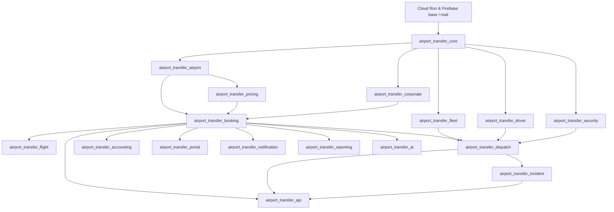

# Cloud Run & Firebase Addon Architecture & Dependency Graph

### 1. Modular Addon Topology
To ensure maintainability, isolated testability, and progressive deployment, the platform backend is divided into 17 modular addons under `cloud/addons/`:

| Module | Core Purpose | Dependencies |
| :--- | :--- | :--- |
| `airport_transfer_core` | Shared mixins, sequences, auditing, base categories, and global utility functions | `base`, `mail` |
| `airport_transfer_airport` | Multi-airport master entities, geofences, terminals, and service zones | `airport_transfer_core` |
| `airport_transfer_corporate` | B2B Corporate client accounts, cost centers, travel managers, credit terms | `airport_transfer_core`, `account`, `portal` |
| `airport_transfer_pricing` | Dynamic fare rules, zone matrices, waiting fees, escort charges, quotations | `airport_transfer_airport`, `airport_transfer_core` |
| `airport_transfer_booking` | Master booking engine, state machine, passenger entities, lifecycle events | `airport_transfer_airport`, `airport_transfer_pricing`, `airport_transfer_corporate`, `portal` |
| `airport_transfer_flight` | Flight master, schedules, provider abstraction, delay monitoring | `airport_transfer_airport`, `airport_transfer_booking` |
| `airport_transfer_fleet` | Fleet extensions, vehicle pools, inspections, maintenance, telematics links | `fleet`, `airport_transfer_core`, `airport_transfer_airport` |
| `airport_transfer_driver` | Driver profiles, license authorizations, duty states, shift assignments | `hr`, `airport_transfer_core`, `airport_transfer_fleet` |
| `airport_transfer_security` | Escort personnel, armed convoy rules, certifications, threat clearance | `hr`, `airport_transfer_core` |
| `airport_transfer_dispatch` | Resource planning, conflict detection, dispatch board, Kanban, assignments | `airport_transfer_booking`, `airport_transfer_fleet`, `airport_transfer_driver`, `airport_transfer_security` |
| `airport_transfer_incident` | Incident command, SOS alarms, breakdown handling, evidence attachments | `airport_transfer_booking`, `airport_transfer_dispatch` |
| `airport_transfer_accounting` | Automated customer invoicing, corporate consolidated statements, refunds | `airport_transfer_booking`, `account` |
| `airport_transfer_portal` | Web customer portal, corporate booking desk, passenger trip viewer | `airport_transfer_booking`, `portal`, `website` |
| `airport_transfer_api` | Versioned REST API layer (`/api/v1/...`), JWT/Auth tokens, mobile serializers | `airport_transfer_booking`, `airport_transfer_dispatch`, `airport_transfer_incident` |
| `airport_transfer_notification` | Push notifications, SMS gateway abstraction, email dispatch templates | `airport_transfer_booking`, `bus` |
| `airport_transfer_reporting` | Operational KPIs, manifests, vehicle utilization, financial analytics | `airport_transfer_booking`, `airport_transfer_accounting` |
| `airport_transfer_ai` | Dispatch optimization recommendations, demand forecasting, anomaly alerts | `airport_transfer_booking`, `airport_transfer_flight` |

---

### 2. Dependency Graph (Mermaid)

